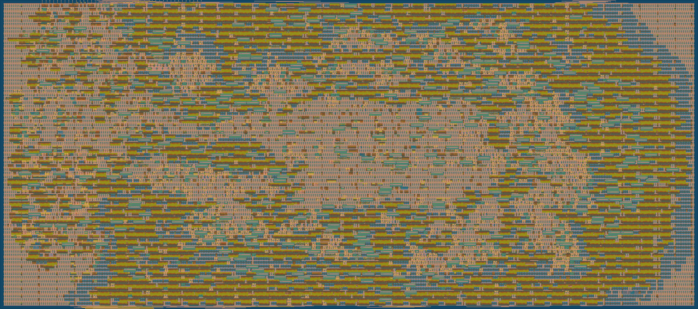

   

# SHA-3 engine for ML-KEM on Tiny Tapeout

A Keccak-f[1600] sponge coprocessor for the hash work of ML-KEM (FIPS 203, the post-quantum key exchange),
taped out on Tiny Tapeout (sky130, 3×2 tiles). A microcontroller runs ML-KEM-512 and hands every SHA3-256,
SHA3-512, SHAKE128 and SHAKE256 call to the chip. On the way out the chip can also sample ML-KEM's secret noise
(SamplePolyCBD) and its public matrix (SampleNTT), so the host gets polynomials back instead of raw bytes.

[](https://gds-viewer.tinytapeout.com/?pdk=sky130A&model=https%3A%2F%2Fsilicap.github.io%2Fchipathon-2026%2Ftinytapeout.oas)
[](https://silicap.github.io/chipathon-2026/gds_render.png)



*The current design, 3×2 tiles, 74 % of the area in cells ([how it was made](#the-layout-images)). The team's
logo is a 28 × 56 µm metal-4 block in the bottom right corner, too small to see here:
[close-up](docs/img/logo_chip_met4.png). The 3D button opens whatever the last GitHub `gds` run published.*

## Why hashing

Hashing is 57–76 % of ML-KEM-512's work on a microcontroller. The polynomial arithmetic (NTT) is fast in software
and slow through 8 output pins, so the team moved the hashing on-chip instead:

| One ML-KEM-512 key exchange | Time | |
|---|---|---|
| RP2350 alone (pqm4's optimized code, cited) | 8.08 ms | |
| RP2350 + this chip at 50 MHz | **3.18 ms** | **2.54× faster** (model: the chip's exact clock counts + the RP2350's feed) |
| of which hashing | 5.81 ms → 1.09 ms | 5.3× |

Measured so far, before silicon (the chip's RTL in an FPGA, the real RP2350 firmware, [speed_results.md](docs/speed_results.md)):
the hashing of one exchange takes **19.7 ms through the chip against 39.9 ms in C on the RP2350 (2.02×)**, every
result checked. The chip's own share is 2.6 ms at 18.75 MHz and 0.96 ms at 50 MHz; the rest is the RP2350 firmware
feeding it, which is where the next speed-up is. `rp2350/speedtest.py` measures it on any board
([getting started](docs/getting_started.md#the-speed-test)).

## The chip

| | |
|---|---|
| Core | Keccak ring, 8 bit-slices per clock: one permutation in 368 clocks (7.4 µs at 50 MHz) |
| Functions | SHA3-256 (H), SHA3-512 (G), SHAKE128 (XOF), SHAKE256 (PRF, J); on-chip padding; packet absorb |
| Helpers | SamplePolyCBD η = 2 / 3 and SampleNTT on the squeeze stream; bursts that permute by themselves |
| Pins | 8 data in, 8 bytes out, command and valid on `uio`; framing mode 1 adds `valid` and `busy` outputs |
| Size, clock | 3×2 tiles, 50 MHz target, Tiny Tapeout's default timing constraints (no custom SDC) |
| Datasheet | [docs/info.md](docs/info.md): every command, pin and timing |

## Status

| Check | Latest (`main`) |
|---|---|
| RTL tests (cocotb, `test/`) | pass |
| GDS, Tiny Tapeout precheck, gate-level test | pass (on the owner's CI server, `host-ci/gds`; GitHub builds when it's down) |
| RP2350 firmware builds, its PC harness | pass (GitHub `rp2350`) |
| The firmware driving the chip's gate netlist, every push | pass (`host-ci/rig`) |
| Silicon | waiting for chips |

Before silicon, the chip and the firmware were tested on an FPGA emulator (a Tang Nano 20K running the chip's gate
netlist, driven by the same RP2350 firmware on a Pico 2 W over 26 wires). That history:
[docs/PICO_TANG_RIG.md](docs/PICO_TANG_RIG.md), [docs/ci-emulator.md](docs/ci-emulator.md).

## Getting started

Everything to test the chip, from simulation to the Tiny Tapeout demo board: [docs/getting_started.md](docs/getting_started.md).

```bash
cd test && make                                  # the chip's RTL in simulation
make -C rp2350/pc test                           # the RP2350 driver against its software chip
python3 rp2350/speedtest.py --select <n>         # on the TT demo board: self-test, wire speed, throughput
```

On the demo board, our firmware (`rp2350/`, `tt_hash_dbv3.uf2`) replaces Tiny Tapeout's MicroPython and drives the
chip through PIO, one pin word per clock.

## What's where

| Path | What |
|---|---|
| `src/` | the chip: `tt_um_NTT_Core.v` (top), `hash_io.v` (commands, bursts, CBD), `sample_ntt.v`, `keccak_ring.v`, `logo/` |
| `test/` | cocotb tests; `hash_jobs.py` builds the pin words for any job |
| `rp2350/` | firmware for the TT demo board (PIO + DMA), its PC build, `speedtest.py` |
| `docs/` | the datasheet ([info.md](docs/info.md)), [getting started](docs/getting_started.md), design notes |

Design history: [tile_routes.md](docs/tile_routes.md) (why a hash chip and why 3×2),
[sha3_only_3x2.md](docs/sha3_only_3x2.md) (signoff), [onchip_offload.md](docs/onchip_offload.md),
[host_ci_findings.md](docs/host_ci_findings.md), [handoff_sha3_only.md](docs/handoff_sha3_only.md). The repo also
keeps the earlier NTT chip's specs (`specs/`, `schematics/`, `tables/`, `research/`) and the pre-silicon test
tools (`fpga/`, `host/`, `local-ci/`).

## The layout images

- **3D:** the button above opens Tiny Tapeout's viewer on the `tinytapeout.oas` that the GitHub `gds` workflow
  publishes to this repo's GitHub Pages. The CI server builds most commits instead, and then GitHub doesn't
  publish. To refresh the 3D view after the last change: *Actions → gds → Run workflow* (a manual run always
  builds on GitHub).
- **2D:** `docs/img/chip_render.png` is rendered from a local build of `main` with the Tiny Tapeout tools
  (`tt_tool.py --create-png`). The 2D button shows the render from the last GitHub run.
- `local-ci/run gds` builds the GDS on your own machine and shows the render and a 3D link on its results page.

## Tiny Tapeout

Tiny Tapeout makes it cheap to get a design manufactured on a real chip: [tinytapeout.com](https://tinytapeout.com),
[FAQ](https://tinytapeout.com/faq/), [local hardening](https://www.tinytapeout.com/guides/local-hardening/).
The GDS is built by the [Tiny Tapeout GDS action](https://github.com/TinyTapeout/tt-gds-action) with LibreLane.
