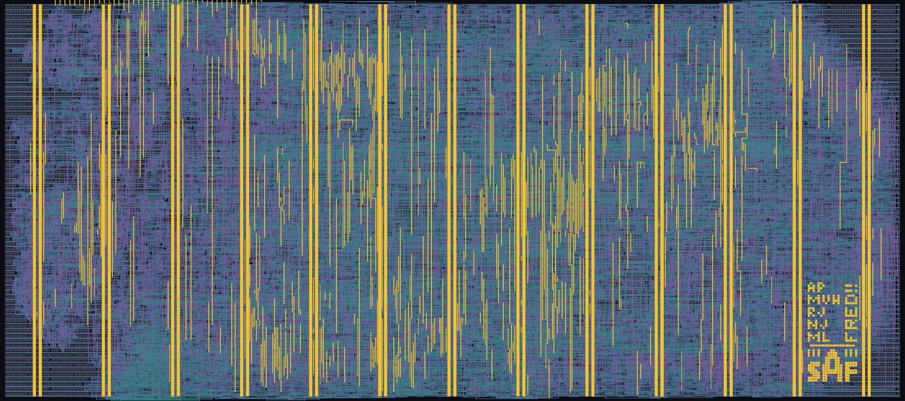

   

# SHA-3 engine for ML-KEM on Tiny Tapeout

A Keccak-f[1600] sponge coprocessor for the hash work of ML-KEM (FIPS 203, the post-quantum key exchange),
taped out on Tiny Tapeout (sky130, 3×2 tiles). A microcontroller runs ML-KEM-512 and hands every SHA3-256,
SHA3-512, SHAKE128 and SHAKE256 call to the chip. On the way out the chip can also sample ML-KEM's secret noise
(SamplePolyCBD) and its public matrix (SampleNTT), so the host gets polynomials back instead of raw bytes.

[](https://gds-viewer.tinytapeout.com/?pdk=sky130A&model=https%3A%2F%2Fsilicap.github.io%2Fchipathon-2026%2Ftinytapeout.oas)
[](https://silicap.github.io/chipathon-2026/gds_render.png)



*The current design, 3×2 tiles: the routing layers, with metal 4 in gold (the power straps and the team's chip art in
the bottom right corner). [Close-up of the chip art](docs/img/chip_art.png), 28 × 56 µm.
[How the images are made](#the-layout-images).*

## Why hashing, and how fast

Hashing is 57–76 % of ML-KEM-512's work on a microcontroller. The polynomial arithmetic (NTT) is fast in software and
slow through 8 output pins, so the team put the hashing on the chip. Measured on the chip's hardened gate netlist
(in an FPGA, driven by the same RP2350 firmware as the demo board), RP2350 at 150 MHz, every result checked.

### Compute only: the chip against the code that does the same work

The C code alone on the RP2350, against the chip's clocks for the same work. CBD and SampleNTT run on the chip too.
No transfers on either side.

| Work | C on the RP2350 | Chip, measured on the FPGA (18.75 MHz) | Chip at 50 MHz | Speed-up |
|---|---|---|---|---|
| One Keccak-f[1600] permutation | 411 µs | 19.6 µs (368 clocks) | 7.4 µs | **56×** |
| H = SHA3-256 of 800 B | 2,614 µs | 165 µs (3,091 clocks) | 61.8 µs | **42×** |
| PRF + SamplePolyCBD, one polynomial (η = 3) | 972 µs | 53.5 µs (1,004 clocks) | 20.1 µs | **48×** |
| XOF + SampleNTT, one polynomial | 1,346 µs | 90.7 µs (1,700 clocks) | 34.0 µs | **40×** |
| SamplePolyCBD alone / SampleNTT alone | 119 µs / 43 µs | no clocks of its own: it runs on the output stream | | |
| **One ML-KEM-512 exchange (32 hash calls)** | **39.8 ms** | **2.33 ms** (43,736 clocks) | **0.87 ms** | **46×** |

The C code is portable FIPS 202 / 203 code. Hand-optimized assembly does the exchange's hashing in about 5.8 ms
(cited); the chip's 0.87 ms is still **6.6× faster** than that.

### The whole system: everything the RP2350 waits for

Building the pin words, the transfers, the chip, unpacking: the hashing of one ML-KEM-512 exchange.

| | Time | vs C |
|---|---|---|
| RP2350 alone, C (measured) | 39.8 ms | |
| **FPGA, measured:** RP2350 + the chip's gate netlist over 26 wires (18.75 MHz) | **5.97 ms** | **6.7×** |
| **Real chip, guesstimate:** demo board, chip at 50 MHz | **≈ 2.8 ms** | **≈ 14×** |
| Real chip, guesstimate: chip at 66 MHz | ≈ 2.6 ms | ≈ 15× |

- **The guesstimate** keeps the RP2350's measured work. It drops the word reshuffling that only the FPGA rig needs
  (its pins aren't consecutive) and runs the chip's clocks at its own speed.
- **Against hand-optimized assembly** (about 5.8 ms), that's still about 2× faster for the whole system.

Details, the firmware work that got here, and the wire speed: [docs/speed_results.md](docs/speed_results.md).
Measure it on any board: `python3 rp2350/speedtest.py` ([getting started](docs/getting_started.md#the-speed-test)).

## The chip

| | |
|---|---|
| Core | Keccak ring, 8 bit-slices per clock: one permutation in 368 clocks (7.4 µs at 50 MHz) |
| Functions | SHA3-256 (H), SHA3-512 (G), SHAKE128 (XOF), SHAKE256 (PRF, J); on-chip padding; packet absorb |
| Helpers | SamplePolyCBD η = 2 / 3 and SampleNTT on the squeeze stream; bursts that permute by themselves |
| Pins | 8 data in, 8 bytes out, command and valid on `uio`; framing mode 1 adds `valid` and `busy` outputs |
| Size, clock | 3×2 tiles, 50 MHz target, Tiny Tapeout's default timing constraints (no custom SDC) |
| Datasheet | [docs/info.md](docs/info.md): every command, pin and timing |

## Status

| Check | Latest (`main`) |
|---|---|
| RTL tests (cocotb, `test/`) | pass |
| GDS, Tiny Tapeout precheck, gate-level test | pass (on the owner's CI server, `host-ci/gds`; GitHub builds when it's down) |
| RP2350 firmware builds, its PC harness | pass (GitHub `rp2350`) |
| The firmware driving the chip's gate netlist on the FPGA rig | pass, Nov 25, 2026: `selftest`, `fuzz 200`, the `ci` ML-KEM-512 hash sequence, `speedtest`, 0 errors ([results](docs/speed_results.md)) |
| Silicon | waiting for chips |

Before silicon, the chip and the firmware were tested on an FPGA emulator (a Tang Nano 20K running the chip's gate
netlist, driven by the same RP2350 firmware on a Pico 2 W over 26 wires). That history:
[docs/PICO_TANG_RIG.md](docs/PICO_TANG_RIG.md), [docs/ci-emulator.md](docs/ci-emulator.md).

## Getting started

Everything to test the chip, from simulation to the Tiny Tapeout demo board: [docs/getting_started.md](docs/getting_started.md).

```bash
cd test && make                                  # the chip's RTL in simulation
make -C rp2350/pc test                           # the RP2350 driver against its software chip
python3 rp2350/speedtest.py --select <n>         # on the TT demo board: self-test, wire speed, throughput
```

On the demo board, our firmware (`rp2350/`, `tt_hash_dbv3.uf2`) replaces Tiny Tapeout's MicroPython and drives the
chip through PIO, one pin word per clock.

## What's where

| Path | What |
|---|---|
| `src/` | the chip: `tt_um_NTT_Core.v` (top), `hash_io.v` (commands, bursts, CBD), `sample_ntt.v`, `keccak_ring.v`, `logo/` |
| `test/` | cocotb tests; `hash_jobs.py` builds the pin words for any job |
| `rp2350/` | firmware for the TT demo board (PIO + DMA), its PC build, `speedtest.py` |
| `docs/` | the datasheet ([info.md](docs/info.md)), [getting started](docs/getting_started.md), design notes |

Design history: [tile_routes.md](docs/tile_routes.md) (why a hash chip and why 3×2),
[sha3_only_3x2.md](docs/sha3_only_3x2.md) (signoff), [onchip_offload.md](docs/onchip_offload.md),
[host_ci_findings.md](docs/host_ci_findings.md), [handoff_sha3_only.md](docs/handoff_sha3_only.md). The repo also
keeps the earlier NTT chip's specs (`specs/`, `schematics/`, `tables/`, `research/`) and the pre-silicon test
tools (`fpga/`, `host/`, `local-ci/`).

## The layout images

- **3D:** the button above opens Tiny Tapeout's viewer on the `tinytapeout.oas` that the GitHub `gds` workflow
  publishes to this repo's GitHub Pages for every push to `main`.
- **2D:** the 2D button shows Tiny Tapeout's own render from the same run (the cell layers; the chip art isn't
  visible there). `docs/img/chip_render.jpg` and `chip_art.png` are rendered from the GDS of `main` with
  `scripts/render_chip.py` (KLayout): the routing layers, metal 4 in gold.
- `local-ci/run gds` builds the GDS on your own machine and shows the render and a 3D link on its results page.

## Tiny Tapeout

Tiny Tapeout makes it cheap to get a design manufactured on a real chip: [tinytapeout.com](https://tinytapeout.com),
[FAQ](https://tinytapeout.com/faq/), [local hardening](https://www.tinytapeout.com/guides/local-hardening/).
The GDS is built by the [Tiny Tapeout GDS action](https://github.com/TinyTapeout/tt-gds-action) with LibreLane.
