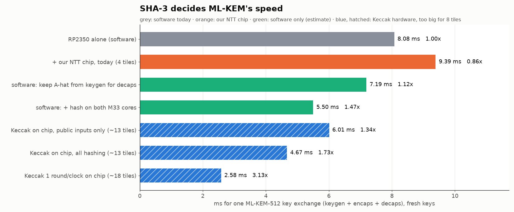

# SHA-3 in ML-KEM-512: why hashing decides our speed, and what we can do about it

*From Viktor's exploration repo, [tt-viktor-chiptor](https://github.com/SiLiCaP/tt-viktor-chiptor), Oct 17 2026.
For the team's information. It follows [architecture_options.md](architecture_options.md) and uses the same
setting: the TT demo board, with the RP2350 at 150 MHz and our chip at 50 MHz. Every number can be
reproduced with [`sim/sha3_options.py`](https://github.com/SiLiCaP/tt-viktor-chiptor/blob/main/sim/sha3_options.py)
and is tagged **measured**, **cited** or **estimate**.*

## Summary

- **Hashing is two thirds to three quarters of ML-KEM-512's time** on the RP2350 (67–76 %, cited). The
  NTT work our chip takes over is 8–14 %.
- So even an infinitely fast NTT unit speeds up ML-KEM by at most 1.08–1.16×. A hashing unit could reach 3–4×.
- **Software can already reach about 1.47× without any silicon** (estimate). It needs two changes: keep the
  matrix  from keygen for decaps, and hash on both M33 cores. Our NTT chip today gives 0.86×.
- **A Keccak core on the chip would give 1.73× at 1,346 clocks per permutation**, measured RTL. But it needs
  about 13 tiles (99k µm², latch state), so it doesn't fit in 8.
- **A hasher on the pins leaks secrets.** 14 of 26 permutations in decaps take secret inputs, and
  unlike the NTT, Keccak can't be protected by simple linear masking on the host.



## 1. What SHA-3 does inside ML-KEM

FIPS 203 uses one primitive, the Keccak-f[1600] permutation, in four roles. Counts are permutations per
operation, measured by instrumenting our FIPS 203 model (decaps without the optional dk check, which pqm4
doesn't do either):

| Function | Used for | Input | keygen | encaps | decaps |
|---|---|---|---|---|---|
| XOF = SHAKE128 | expand seed ρ into the 2×2 matrix  (rejection sampling) | public ρ | 12 | 12 | 12 |
| H = SHA3-256 | hash the 800-byte public key | public ek | 6 | 6 | – (stored in dk) |
| PRF = SHAKE256 | sample the small secret and noise polynomials | **secret** σ or r | 8 | 7 | 7 |
| J = SHAKE256 | implicit-rejection key from z and the ciphertext | **secret** z | – | – | 6 |
| G = SHA3-512 | derive seeds (keygen) and the shared key (encaps, decaps) | **secret** d or m | 1 | 1 | 1 |
| **total** | | | **27** | **26** | **26** |
| with public inputs only | | | 18 | 18 | 12 |

None of this is optional: ML-KEM's security proof (the Fujisaki–Okamoto transform) and its
interoperability depend on these exact hash calls. Any implementation that gives the FIPS 203 outputs must
compute them.

## 2. Where the time goes

RP2350 alone, pqm4 cycle counts at 150 MHz (cited; pqm4 measures a Cortex-M4, and we assume the
RP2350's M33 is similar):

| | Total | SHA-3 / SHAKE | NTT, basemul | Rest | Per permutation |
|---|---|---|---|---|---|
| keygen | 2.62 ms | 1.98 ms (76 %) | 0.20 ms (8 %) | 0.44 ms | 73 µs |
| encaps | 2.61 ms | 1.92 ms (73 %) | 0.25 ms (10 %) | 0.44 ms | 74 µs |
| decaps | 2.85 ms | 1.92 ms (67 %) | 0.39 ms (14 %) | 0.55 ms | 74 µs |

"Per permutation" is the hashing time divided by the permutation count, so it includes absorbing and
squeezing. pqm4 already uses an assembly Keccak, so there's little left to gain from tuning the same code.

**Why this matters for our chip:** by Amdahl's law the NTT side caps out at 1.08–1.16×, and our chip
today, limited by the output pins, makes ML-KEM 0.86× as fast as software (see architecture_options.md).
The remaining time is mostly hashing, so that's where any real speed-up has to come from.

The RP2350 has a SHA-256 accelerator, but FIPS 203 requires SHA-3 and SHAKE, so it doesn't help.

## 3. Option A: software only, no silicon (estimates)

| Change | What it does | keygen | encaps | decaps | Exchange |
|---|---|---|---|---|---|
| none | today | 2.62 ms | 2.61 ms | 2.85 ms | 8.08 ms, 1.00× |
| **keep  from keygen** | Alice already expanded  in keygen. Keeping it (1.5 kB of SRAM) saves the 12 XOF permutations in decaps | 2.62 | 2.61 | 1.97 | 7.19 ms, 1.12× |
| **+ hash on both cores** | The 4 XOF polynomials and the PRF calls are independent, so they can be split across the two M33 cores | 1.88 | 1.91 | 1.71 | **5.50 ms, 1.47×** |

Two more cases, outside one fresh exchange:
- A device with a long-term key keeps  and saves those 12 permutations in every decaps.
- Repeated encapsulation to the same peer can keep  and H(ek): encaps 2.61 → 1.28 ms (2.0×).

Both changes give byte-identical FIPS 203 outputs, since they only avoid recomputing values. The dual-core
numbers assume no synchronization overhead. They also conflict with the final system as drawn, where
core 1 feeds the NTT chip. **On today's numbers, the fastest ML-KEM-512 on the demo board is pure software
with these two changes.**

## 4. Option B: a Keccak engine on the chip

Measured cores (sky130, Yosys + ABC, RTL verified against hashlib) and published compact cores:

| Keccak-f[1600] core | Area | Clocks / perm. | vs RP2350 per perm. | Tiles | Exchange |
|---|---|---|---|---|---|
| Pessl & Hutter, CHES 2013 | ~21k µm² (5.5k GE, estimate) | ~15,000 | 4× slower | fits | slower than SW |
| Keccak team, compact | ~35k µm² (9.3k GE, estimate) | 5,160 | 1.4× slower | fits | slower than SW |
| ours, lane-serial, latch state | **99k µm² (measured)** | **1,346 (measured)** | 2.7× faster | ~13 | **4.67 ms, 1.73×** |
| ours, lane-serial, flip-flop state | 151k µm² (measured) | 1,346 | 2.7× faster | ~19 | 4.67 ms, 1.73× |
| 1 round per clock | 145k µm² (measured) | 24 | 100× faster | ~18 | 2.58 ms, 3.13× |

What sets the area:
- **The 1,600-bit state, not the round logic.** Spending more clocks per permutation saves almost no area.
  Each state bit needs a write-enabled flip-flop (about 30 µm²) or a latch, and the core reads lanes through
  a 25:1 mux.
- **The speed bar is high.** To beat the RP2350 at 50 MHz, a core needs fewer than about 3,700 clocks per
  permutation. Every published core small enough for 8 tiles is slower than that.
- **SRAM is the one thing that could change this.** The state is only 200 bytes. If Tiny Tapeout lets a
  project instantiate a sky130 SRAM macro, a lane-serial core with its state in SRAM could fit. We found
  no evidence yet that it's allowed (see the question in section 6).
- **A Keccak-only chip at 8×2 (16 tiles)** would fit the latch core by our estimate. Latches complicate
  timing signoff in the TT flow, though, and the NTT chip would barely fit next to it (about 122k µm²
  together, an estimate).

The pin protocol for a hasher is already drafted: command words on the existing pins, 1 byte per clock in
and out, and a fixed-length permutation. See spec change 2 in tt-viktor-chiptor (`docs/spec-changes/02_hasher_engine.md`).

## 5. The security catch: hashing on the chip puts secrets on the pins

Our NTT chip has the same problem: the secret polynomial crosses the pins in the clear, and on the FPGA a
pin probe recovered 256 of 256 secret coefficients. Its fix is cheap because the NTT is linear. The host
sends two random shares and adds the results, so the probe sees noise.

**Keccak isn't linear**, so that trick doesn't work. The secret inputs are the master seed d (keygen),
σ and r (PRF), m (encaps) and z (decaps). A hasher on the pins exposes them, and d is enough to rebuild
the whole private key. A masked Keccak core costs a multiple of the unmasked area, because the nonlinear
χ step needs fresh randomness and logic for each share.

What is still safe: offload only the calls with public inputs (XOF from ρ, and H of the public key). That
covers 18 of 27 permutations in keygen and 12 of 26 in decaps. It gives **6.01 ms, 1.34×** (estimate),
less than the 1.73× of doing everything on the chip but with nothing secret on the pins.

## 6. What this means for the team

1. **Keep the NTT chip's goal as a working, verified, constant-time demonstrator.** It can't make ML-KEM
   faster on its own, and the reason is SHA-3, not our NTT design.
2. **Implement the two software changes in the RP2350 firmware** (Spec 1 harness): keep Â, and hash on
   both cores. They're free, give about 1.47×, and also speed up the demo with the chip attached.
3. **Ask the Tiny Tapeout organizers (Discord):** can a project instantiate a sky130 SRAM macro, and how
   big? That's the only route we see to a fast hasher in 8 tiles.
4. **If more area ever becomes available** (8×2, or SRAM), a Keccak engine for the public-input calls is
   the safest first step: 1.34×, and nothing secret on the pins.
5. **In the presentation**, the honest line is "SHA-3, not the NTT, sets ML-KEM's speed". That's a
   finding, not a failure.

## Reproduce

In [tt-viktor-chiptor](https://github.com/SiLiCaP/tt-viktor-chiptor):

```bash
python3 sim/sha3_options.py          # the tables in sections 2-4 and the chart
python3 sim/arch_explore.py          # all architecture options, tile fit, clock sweep
make -C sim/arch_explore_rtl         # the lane-serial Keccak RTL against hashlib (Makefile.lat for latches)
```

## Sources

- FIPS 203, Module-Lattice-Based Key-Encapsulation Mechanism Standard, NIST, August 2024.
- pqm4 benchmarks (m4fspeed cycles and hashing share), commit 5e5cc76, https://github.com/mupq/pqm4
- P. Pessl, M. Hutter, "Pushing the Limits of SHA-3 Hardware Implementations to Fit on RFID", CHES 2013,
  https://eprint.iacr.org/2013/439
- G. Bertoni, J. Daemen, M. Peeters, G. Van Assche, R. Van Keer, "Keccak implementation overview" v3.2,
  https://keccak.team/files/Keccak-implementation-3.2.pdf
